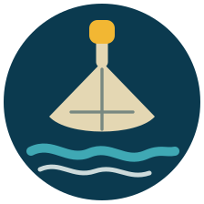

# بلّط البحر — Ballet l Ba7er

**[Play it in the browser →](https://merhii.github.io/ballet-l-baher/)**

*"Ballet l ba7er"* — "go tile the sea" — is what you say in Lebanon to end an
argument, or to send someone off on a gloriously pointless errand.

So: a 3D game where you do it. You are a mason on the Saida corniche with a
wheelbarrow of mouna and a stack of balat. You walk down the public stairs and
lay tiles out over the Mediterranean. The sea eats your edges. You lay more.

Interior tiles are safe forever — only the frontier is contested — so the game
is a slow argument with the water about where the edge is.

## The coast

Saida, and only Saida: Qalaat al-Bahr on its causeway, the harbour mole with
its beacon, Jazirat Ziri low on the horizon, Khan el-Franj and the ruin of
Qalaat al-Muizz inland, Mount Lebanon behind. Five people on the corniche who
will talk to you, including an uncle on the railing who thinks you are wasting
your life.

## Controls

| | |
|---|---|
| `WASD` / `SHIFT` / `SPACE` | walk / run / jump |
| mouse | look (click once to capture it) |
| `[` `]` | mouse sensitivity |
| click / hold click | lay a balata / sweep a row |
| hold `E` at a pile | shovel mouna |
| `E` beside someone | talk to them |
| `V` | first / third person |
| `M` | sound |

## Building

No toolchain, no dependencies, no build step worth the name:

```sh
./build.sh           # inlines the modules into one HTML file
node test/smoke.js   # headless contract + simulation checks
```

`build.sh` emits `dist/artifact.html` (for embedding), `dist/local.html` (open
it straight off disk) and `docs/index.html` (what Pages serves — Three.js
inlined, so the only network request is the Google Fonts stylesheet).

Source is four plain scripts — `physics.js` (waves, erosion, player body),
`world.js` (all the scenery), `hud.js` (2D overlay and procedural audio) and
`game.js` (engine and integration). `SPEC.md` is the contract they were built
against.

## Brand

`brand/logo-trowel.svg` is the mark: a trowel seen from above, its blade
scored like a balata, laid over a wave. `brand/favicon.svg` is the same mark
cut down for small sizes — the handle knob, the grout cross and the foam line
all disappear below about 32px, so they are dropped and the wave is thickened.
Both are font-free, so they render anywhere.

## Credits

Three.js r128, MIT. Everything else — geometry, textures, sound — is generated
at runtime; there are no asset files in this repository.
