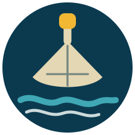

# بلّط البحر — Ballet l Ba7er

**[Play it in the browser →](https://merhii.github.io/ballet-l-baher/)**

*"Ballet l ba7er"* — "go tile the sea" — is what you say in Lebanon to end an
argument, or to send someone off on a gloriously pointless errand.

So: a 3D game where you do it. You are a mason on the Saida corniche with a
wheelbarrow of mouna and a stack of balat. You walk down the public stairs and
lay tiles out over the Mediterranean. The sea eats your edges. You lay more.

Interior tiles are safe forever — only the frontier is contested — so the game
is a slow argument with the water about where the edge is.

## The coast

Saida, and only Saida: Qalaat al-Bahr on its causeway, the harbour mole with
its beacon, Jazirat Ziri low on the horizon, Khan el-Franj and the ruin of
Qalaat al-Muizz inland, Mount Lebanon behind. Five people on the corniche who
will talk to you, including an uncle on the railing who thinks you are wasting
your life.

## Staying alive

Two bars. **Stamina** drains as you work, run and swim. **Health** is what the
sea takes: waves breaking over the frontier tile you are standing on, cold
water, swimming with no stamina left, a long fall, working on an empty stomach.
At zero you pass out, wake on the corniche, and the hospital sends a bill.

You eat at **Souk el Akel**, the food court east of the stairs — Helwayet el
Samra (sweets and bouza, which halves your stamina drain for ninety seconds),
Soubras (sandwiches that keep healing you for a minute) and Falafel Akkawi — or
at Knefe Jardali. Walk to a counter and press `E`. Sahet el Qal3a, the court by
the castle, is shuttered until it opens.

## Billboards and the CMS

Five billboards stand in the world: two hoardings behind the promenade, one on
each food-court roof, and one on a plinth out on the harbour mole. They rotate
through the ads in `ads.json` (text and colour, painted on a canvas at runtime —
still no asset files). A board with nothing booked advertises itself: "ad space
coming soon, inquire in Credits".

`cms.html` edits them: sponsor, Arabic name, headline, layout, colours, which
board each ad runs on, weight, start and end dates. It is **not** published with
the game — open it straight from the repo folder on your own machine. It reads
what is live from the site; **Publish** commits `ads.json` and `docs/ads.json`
through the GitHub API with your fine-grained token (kept in that tab only), and
Pages redeploys. Without the token nobody can change the billboards, even with a
copy of the page. **Preview in game** shows a draft in this browser only — open
`docs/index.html` from the repo folder to see it. Impressions are counted per
browser only — there is no server.

## Controls

| | |
|---|---|
| `WASD` / `SHIFT` / `SPACE` | walk / run / jump |
| mouse | look — the view follows the mouse, no button needed; a click also captures it |
| `[` `]` | mouse sensitivity |
| click / hold click | lay a balata / sweep a row |
| hold `E` at a pile | shovel mouna |
| `E` beside someone | talk to them, or buy food at a counter |
| `Esc` / `P` | pause menu |
| `V` | first / third person |
| `M` | sound |

## Building

No toolchain, no dependencies, no build step worth the name:

```sh
./build.sh           # inlines the modules into one HTML file
node test/smoke.js   # headless contract + simulation checks
```

On Windows without Python, `.\build.ps1` produces the same outputs.

`build.sh` emits `dist/artifact.html` (for embedding), `dist/local.html` (open
it straight off disk) and `docs/index.html` (what Pages serves — Three.js
inlined, so the only network request is the Google Fonts stylesheet).

Source is five plain scripts — `ads.js` (billboard schema and renderer, shared
with the CMS), `physics.js` (waves, erosion, player body),
`world.js` (all the scenery), `hud.js` (2D overlay and procedural audio) and
`game.js` (engine and integration). `SPEC.md` is the contract they were built
against.

## Brand

`brand/logo-trowel.svg` is the mark: a trowel seen from above, its blade
scored like a balata, laid over a wave. `brand/favicon.svg` is the same mark
cut down for small sizes — the handle knob, the grout cross and the foam line
all disappear below about 32px, so they are dropped and the wave is thickened.
Both are font-free, so they render anywhere.

## Credits

Three.js r128, MIT. Everything else — geometry, textures, sound — is generated
at runtime; there are no asset files in this repository.
